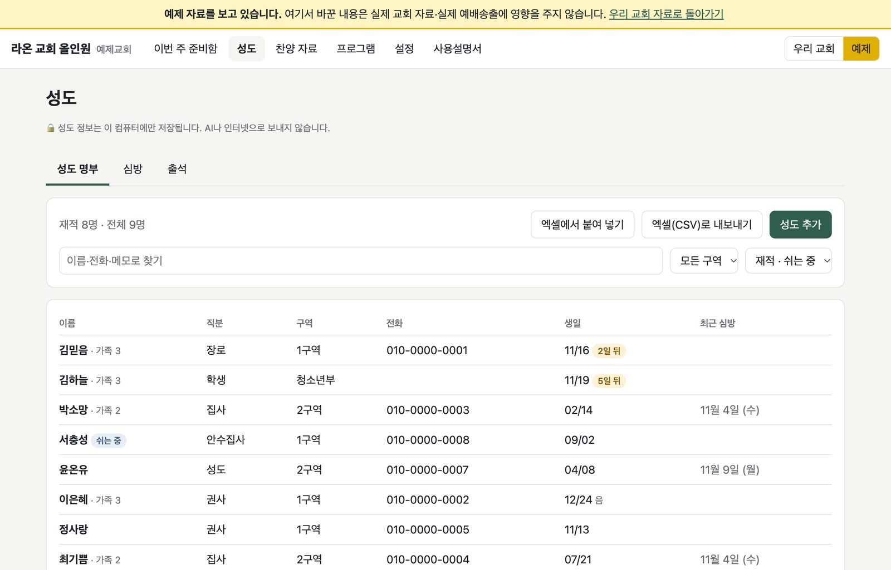

# 라온 교회 올인원

> 혼자 목회해도, 매주 준비를 혼자 다 하지 않도록.

1인 목회자를 위한 **이번 주 예배 준비 화면**입니다. 본문과 설교 제목을 한 번만 넣으면 예배 자막, 찬양 콘티, 설교 후 자료까지 이어집니다. 성도 명부·재정·행정(일정·회의록·봉사 배정·증명서)도 같은 화면에서 관리합니다.

맥과 윈도우에서 쓰고, **무료로 나눕니다.** 회원 가입이나 우리 쪽 서버가 없고, 자료는 설치한 그 컴퓨터에만 저장됩니다.

**[소개 페이지 · 받는 곳](https://raon-easypaster.github.io/church-allinone/)** · [최신 릴리스](https://github.com/raon-easypaster/church-allinone/releases/latest) · [카카오 오픈채팅 문의](https://open.kakao.com/o/gSkET2Wi)


---

## 받기

[최신 릴리스](https://github.com/raon-easypaster/church-allinone/releases/latest)에서 받습니다.

| 파일 | 대상 |
|---|---|
| **ChurchAllInOne-mac.zip** | 맥 (애플 칩·인텔) |
| **ChurchAllInOne-windows.zip** | 윈도우 10·11 |
| ChurchAllInOne-update.zip | 프로그램 안 자동 업데이트용 (직접 받을 필요 없음) |
| SHA256SUMS.txt | 받은 파일이 원본과 같은지 확인하는 값 |

한 묶음에 아래 프로그램이 모두 들어 있습니다.

| 프로그램 | 하는 일 |
|---|---|
| **라온 교회 올인원** | 이번 주 예배 준비, 설교 후 자료, 성도·재정·행정 |
| [**예배송출**](https://github.com/raon-easypaster/worship-caster) | 예배당 TV·유튜브(OBS) 자막, 찬양 가사·곡 구성 |
| **PraiseFlow 찬양 큐레이터** | 본문·설교 제목으로 찬송가와 CCM 추천 |
| [**설교 쇼츠 제작**](https://github.com/raon-easypaster/sermon-shorts-maker) | 설교 유튜브 링크로 하이라이트를 찾아 자막 넣은 쇼츠 영상 만들기 |
| [**HWP/PDF 변환기**](https://github.com/raon-easypaster/hwp-pdf-to-markdown) | 한글·PDF 문서를 글(마크다운)로 바꾸기 |

## 설치

처음 한 번은 경고 창이 나옵니다. 유료 인증을 받지 않은 무료 프로그램이라 나오는 안내입니다.

**🍎 맥**
1. `ChurchAllInOne-mac.zip`을 두 번 눌러 압축을 풉니다.
2. `설치하기.command`를 **마우스 오른쪽 버튼 → 열기**로 실행합니다. "확인되지 않은 개발자" 창이 뜨면 다시 **[열기]**를 누릅니다.
3. 몇 분 뒤 바탕화면에 **라온 교회 올인원**이 생기고 열립니다. 인터넷이 필요하고, 관리자 암호는 필요 없습니다.

**🪟 윈도우**
1. `ChurchAllInOne-windows.zip`을 오른쪽 클릭 → **모두 압축 풀기**.
2. `라온 교회 올인원` 폴더를 문서 폴더 같은 곳에 둡니다.
3. `라온 교회 올인원 실행.cmd`를 두 번 누릅니다. 설치 과정 없이 바로 열립니다(Node.js가 들어 있음). "Windows의 PC 보호" 창이 뜨면 **[추가 정보] → [실행]**.
4. 설교 쇼츠 메이커는 올인원 위 메뉴 **프로그램**에서 **설치하기**를 한 번 누르면 설치됩니다.

**새 버전**이 나오면 프로그램이 알려 주고, **지금 업데이트**를 누르면 받아서 설치하고 다시 켜집니다(v0.2.5부터). 같은 방법으로 새 묶음을 받아 설치(윈도우는 폴더 바꾸기)해도 됩니다. 어느 쪽이든 입력한 교회 자료는 그대로 남습니다.

처음 열면 교회 이름을 넣고 시작하거나, **예제**로 먼저 둘러볼 수 있습니다. 예제에서 바꾼 것은 실제 자료와 예배송출에 영향이 없습니다.

## 할 수 있는 것

### 이번 주 예배 준비
- **예배 정보:** 날짜·본문·설교 제목·대표 기도·광고를 한 번 넣으면 예배송출 자막(성경 봉독·말씀 선포·대표 기도·교회 소식)에 저절로 들어갑니다.
- **찬양 콘티:** 곡 넣기, 순서·조성·곡 구성 정하기. PraiseFlow 추천 곡을 바로 콘티에 넣습니다.
- **자막 확정:** 예배 순서와 모든 자막을 확정본으로 떠 둡니다. 확정 뒤 바뀐 곳을 알려 주고, 확정본으로 되돌릴 수 있습니다.
- **결과물:** 준비 상태 점검, 카톡용 콘티 글 복사, 콘티 인쇄.

### 설교 후 자료 (AI)
설교 원고 한 편으로 9가지를 만듭니다. 원고는 붙여 넣거나 워드(.docx)·한글(.hwpx)·글(.txt) 파일에서 가져옵니다.

| 묶음 | 자료 |
|---|---|
| 성도와 나누기 | 설교 인포그래픽, 카드뉴스·말씀카드(그림으로 저장), 주보·문자용 요약, 블로그 글 |
| 소그룹·가정 | 장년 소그룹 나눔지(90분), 청소년 소그룹 나눔지(75분), 한 주 묵상(주일~토요일), 가정예배지 |
| 목회자용 | 설교 점검(분량·구조·다듬을 점·적용 점검, 신학은 판단하지 않음) |

- **아직 안 만든 자료 한꺼번에 만들기**를 누르면 두 개씩 차례로 만듭니다.
- 성경 구절·예화·원어 설명은 **원고에 있는 것만** 쓰도록 지시합니다. 그래도 나누기 전에 꼭 한 번 읽어 봐 주세요.
- 설정의 **신학 관점·말투**(예: 웨슬리안 성결 신학·사중복음)를 적어 두면 함께 반영합니다.
- 같은 화면의 **설교 쇼츠 영상** 줄에서 영상 주소를 복사한 채로 설교 쇼츠 제작을 엽니다.


### 교회 살림
- **성도:** 명부(가족 묶기, 엑셀 붙여 넣기, CSV 내보내기), 심방 기록·예정, 출석 체크, 성도 한 분의 기록 모아보기(심방·출석·헌금·봉사·증명서·회의 참석). 홈 화면에 이번 주 생일·심방 예정·3주 연속 결석과 이번 주 봉사가 나옵니다.
- **재정:** 수입·지출 장부, 예산·결산 보고서 인쇄, 기부금 영수증(성도 명부 주소 포함), 항목 직접 편집, 예전 회계장부 백업 가져오기.
- **행정:** 교회 일정 달력과 구글 캘린더 받아 보기, 예배 봉사 배정표(돌아가며 채우기·인쇄), 교인·세례 증명서와 발급 대장.
- **회의록 작성기:** 녹음하거나 녹음 파일을 넣으면 이 컴퓨터에서 받아 적고(whisper), AI가 내용·결정 사항·해야 할 일로 정리합니다.



## 필요한 것과 비용

| 기능 | 필요한 것 | 비용 |
|---|---|---|
| 기본 기능 (예배 준비·콘티·자막·성도·재정·행정) | 프로그램만 설치 | 무료 |
| AI 기능 (설교 후 자료·찬양 추천·회의록 정리) | Claude 유료 구독 + [Claude Code](https://claude.com/claude-code) 로그인, 또는 ChatGPT 유료 구독 + Codex 로그인 | 이미 내시는 구독 안에서 (API 키·추가 요금 없음) |
| 찬양 추천을 Gemini로 | Google Gemini API 키 | 구글 무료 사용량 안에서는 무료 |
| 회의 녹음 받아 적기 | 음성 인식 엔진·모델 처음 한 번 받기 (맥은 `brew install whisper-cpp`) | 무료 (이 컴퓨터에서 처리) |
| 설교 쇼츠 제작 | 쇼츠 화면의 'AI 연결' (구독 로그인 또는 Gemini API 키) | 위와 같음 |
| HWP/PDF 변환기 | 파이썬 3 (맥은 개발자 도구에 들어 있음, 윈도우는 [python.org](https://www.python.org/downloads/)에서 'Add Python to PATH' 체크) | 무료 |

AI 구독이 없어도 기본 기능은 모두 쓸 수 있습니다. 구독 종류와 조건은 각 회사 정책에 따라 바뀔 수 있습니다(2026년 11월 기준).

**AI 연결:** 터미널(윈도우는 PowerShell)에서 `claude`(Claude 구독) 또는 `codex login`(ChatGPT 구독)으로 로그인한 뒤, 올인원의 설교 후 자료 탭에서 **다시 확인**을 누릅니다.

## 자료와 개인정보

| | |
|---|---|
| 저장 위치 | 맥 `교회 올인원/data` 폴더 · 윈도우 `%APPDATA%\ChurchAllInOne`. 찬양 가사·자막은 예배송출이 따로 저장합니다. |
| 자동 백업 | 매일 한 번, 14일치를 같은 컴퓨터 안(`backups` 폴더)에 보관합니다. 컴퓨터 고장에 대비해 가끔 USB 등에 자료 폴더를 복사해 두세요. |
| AI로 보내는 것 | 직접 단추를 누를 때만, 그 일에 필요한 글(설교 원고, 본문·제목, 녹취록)이 로그인된 AI로 갑니다. |
| 보내지 않는 것 | 성도 명부·심방·출석, 재정·영수증, 증명서, 회의 녹음 파일은 AI나 인터넷으로 보내지 않습니다. 녹음 받아 적기도 이 컴퓨터 안에서 합니다. |
| 인터넷을 쓰는 곳 | AI 기능, 가사 검색, 구글 캘린더 받아 오기, 처음 설치와 음성 인식 모델 받기 |

AI가 만든 웹페이지는 따로 떨어진 상자(sandbox)에서만 열어, 올인원 자료에 손대지 못하게 합니다.

## 방송실·성도 컴퓨터

자막만 띄우는 방송실 컴퓨터나 자막 담당 성도의 컴퓨터에는 [예배송출](https://raon-easypaster.github.io/worship-caster/)만 설치하면 됩니다. 목회자나 성도가 자기 컴퓨터(집에서도)에서 준비한 뒤, 예배송출의 **백업 → 복원**으로 방송실 컴퓨터에 옮깁니다.

## 사용법

프로그램 위 메뉴 **사용설명서**에 처음 시작, 매주 준비 순서, 설교 후 자료, AI 연결, 백업, 자주 묻는 질문을 화면 사진과 함께 정리했습니다. 교회 정보를 넣기 전에도 볼 수 있습니다.

## 문의와 후원

- 문의: [카카오 오픈채팅](https://open.kakao.com/o/gSkET2Wi) · [GitHub 의견 게시판](https://github.com/raon-easypaster/church-allinone/issues)
- 라온 교회 올인원은 자율 후원으로 운영됩니다. 후원은 부담을 갖지 않으셔도 됩니다. 무료로 사용하셔도 괜찮습니다.
  - 카카오뱅크 3333-01-9034483 (이광복)
  - 프로그램 안에서는 '설정' 화면 아래와 모든 화면 맨 아래 '후원 안내'에서 볼 수 있습니다.

---

## 개발자용

### 실행

```bash
npm install && npm run build && npm start   # http://localhost:5191
```

- 개발: `npm run dev` (서버 5191 + 화면 5192) · 형식 검사와 빌드: `npm run build`
- **전체 점검: `npm run verify`** (형식 검사 · 빌드 · vitest · 서버 API · 헤드리스 크롬 화면 점검). 하나라도 실패하면 끝 코드 1이고, 배포 스크립트는 이 점검을 먼저 돌려 실패하면 배포 파일을 만들지 않습니다. 시험 서버는 임시 자료 폴더·다른 포트로 띄우므로 실제 자료와 켜져 있는 프로그램은 건드리지 않습니다. 작업 규칙은 [CLAUDE.md](CLAUDE.md)에 있습니다.
- 맥에서는 `교회 올인원 열기.command`를 두 번 눌러도 됩니다.
- 환경 변수: `PORT`(기본 5191), `HUB_DATA_DIR`(기본 `./data`), `WC_URL`(기본 `http://127.0.0.1:5300`), `PRAISEFLOW_URL`

### 구조

| 위치 | 내용 |
|---|---|
| `server/` | Node 서버(런타임 npm 부품 없음). `index.mjs` 시작 파일(받아 둔 새 버전 고르기), `main.mjs` 주소 처리, `update.mjs` 새 버전 알림·자동 설치, `after.mjs` 설교 후 자료 지시문, `people`·`finance`·`admin.mjs` 교회 살림, `ai.mjs` 구독 AI 실행, `stt.mjs` 녹취(whisper.cpp), `ical.mjs` 캘린더 |
| `src/` | React + Vite 화면 |
| `apps.json` | 이어 주는 프로그램 목록(포트, 맥 실행 명령, 윈도우 `win` 설정) |
| `docs/` | 소개 페이지(GitHub Pages). 화면 사진은 모두 예제 자료(`?ws=sample`)로 찍었습니다. |
| `installer/` | 설치 묶음 만들기 |
| `tests/` | 전체 점검 `run.js`, vitest 시험(`*.test.ts`), 서버·화면 점검(`harness/`) |

- 자료: `data/real.json`(우리 교회), `data/sample.json` + `data/sample-caster.json`(예제), 녹음 `data/recordings/`, 매일 백업 `data/backups/`(14일).
- **예제 모드**는 실제 예배송출을 건드리지 않는 가상 예배송출을 씁니다. 예제 찬양 가사는 저작권 문제를 피하려고 직접 쓴 글입니다.
- 예배송출에는 같은 컴퓨터 안에서 서버끼리만 요청합니다(예배송출 보안 규칙상 브라우저에서 직접 부를 수 없음). 예배 기록을 지워도 예배송출의 예배 순서는 지우지 않습니다.
- 예배송출은 수정 즉시 송출 화면에 반영되고, 조성·곡 구성은 곡 자체에 저장됩니다(다른 주에도 같이 바뀜). 그래서 **자막 확정** 때 예배 순서와 모든 자막을 따로 떠 둡니다.

### 설치 묶음 만들기

- **맥** `installer/make-package.sh [만들 위치]` → `교회올인원-설치-날짜.zip`
  - 라온 교회 올인원 + 예배송출.app + PraiseFlow + 설교 쇼츠 제작 + HWP/PDF 변환기.
  - 교회 자료(`data`), API 키(`.env.local`), `node_modules`, 백업 폴더는 넣지 않습니다.
  - 설교 쇼츠 제작(최신 릴리스)과 HWP/PDF 변환기는 이 컴퓨터의 폴더(개인 영상·작업 파일)가 아니라 공개 저장소에서 받아 넣습니다.
  - 받는 맥의 `설치하기.command`는 Node.js가 없으면 nodejs.org 공식 파일(체크섬 확인)을 `~/.local/node`에 설치하고, 각 프로그램을 설치하고, 바탕화면 아이콘을 만듭니다. 다시 실행하면 올인원 프로그램만 바꾸고 자료와 다른 프로그램은 그대로 둡니다.
- **윈도우** `installer/make-windows.sh [만들 위치]` → `ChurchAllInOne-windows.zip`
  - 공식 `node.exe`(체크섬 확인), 빌드된 올인원·PraiseFlow 화면, [예배송출 최신 윈도우판](https://github.com/raon-easypaster/worship-caster/releases/latest)과 설교 쇼츠 메이커 공식 설치 파일(둘 다 체크섬 확인), HWP/PDF 변환기 원본을 한 폴더에 묶습니다.
  - 자료는 `%APPDATA%\ChurchAllInOne`(예배송출은 `%APPDATA%\WorshipCaster`)에 저장되어 폴더를 바꿔도 남습니다.
  - 윈도우에서는 `apps.json`의 `win` 설정으로 켭니다. 설교 쇼츠 메이커는 설치 파일로 설치한 뒤 자기 창으로 열리고(`exe`·`installer`), HWP 변환기는 `start-hub.cmd`로 켭니다.
- **자동 업데이트 묶음** `installer/make-update.sh [만들 위치]` → `ChurchAllInOne-update.zip` (맥·윈도우 공통: `server`·빌드된 `dist`·`apps.json`·`package.json`).
  - 프로그램은 6시간마다 [Releases latest](https://github.com/raon-easypaster/church-allinone/releases/latest)를 확인합니다. 이 파일과 `SHA256SUMS.txt`, 그 서명 `SHA256SUMS.txt.sig`가 릴리스에 있어야 자동 설치합니다.
  - **서명 확인**: 확인값 목록(`SHA256SUMS.txt`)에 Ed25519로 서명합니다. 프로그램은 `server/update-keys.mjs`에 든 공개 열쇠로 서명을 먼저 확인하고, 맞지 않으면 설치하지 않습니다. 릴리스 파일과 확인값 목록을 함께 바꿔치기해도, 비밀 열쇠가 없으면 서명을 만들 수 없습니다.
    - 비밀 열쇠는 저장소에 넣지 않고 배포하는 맥의 `~/.raon-workspace/signing/church-allinone-update.key`에만 둡니다. 처음 한 번 `node installer/signing.mjs keygen`으로 만듭니다.
    - **비밀 열쇠를 잃어버리면** 이미 설치된 프로그램이 새 릴리스를 자동 설치하지 못합니다. 그때는 새 열쇠를 만들어 새 버전을 사용자가 직접 한 번 설치해야 합니다. 그러니 USB나 암호 관리 프로그램 등에 따로 보관하세요.
    - 열쇠를 바꿀 때는 새 공개 열쇠를 `update-keys.mjs`에 더하고, 옛 열쇠로 설치된 프로그램이 모두 새 버전으로 바뀐 뒤에 옛 열쇠를 뺍니다.
  - 받는 주소는 이 저장소의 `releases/download/`로만 제한합니다. 서명과 확인값이 맞을 때만 자료를 백업하고, 자료 폴더 `app-update/버전`에 다 푼 뒤 `current.json`을 바꿉니다.
  - 켤 때 `server/index.mjs`(시작 파일, `server/boot.mjs`)가 앱보다 새 버전이 받아져 있으면 그 `main.mjs`를 켭니다. 켜지 못하면 치우고 앱에 든 버전으로 켭니다. 앱이 더 새것이면 받아 둔 것은 지웁니다.
  - 맥 `.app`이나 앱 폴더의 파일은 고치지 않습니다.
- 배포 순서: `package.json` 버전 올리기 → **`installer/make-release.sh`** 한 번 (전체 점검 → 세 묶음 → `SHA256SUMS.txt` → 서명 `SHA256SUMS.txt.sig` → 서명 다시 확인) → 릴리스에 다섯 파일 올리기.

### 앞으로

- 주보 인쇄 양식(교회별 양식, 모바일 주보)

---

만든 사람: **쉬운목사 이광복** (라온동행교회) · 무료로 나눕니다.
