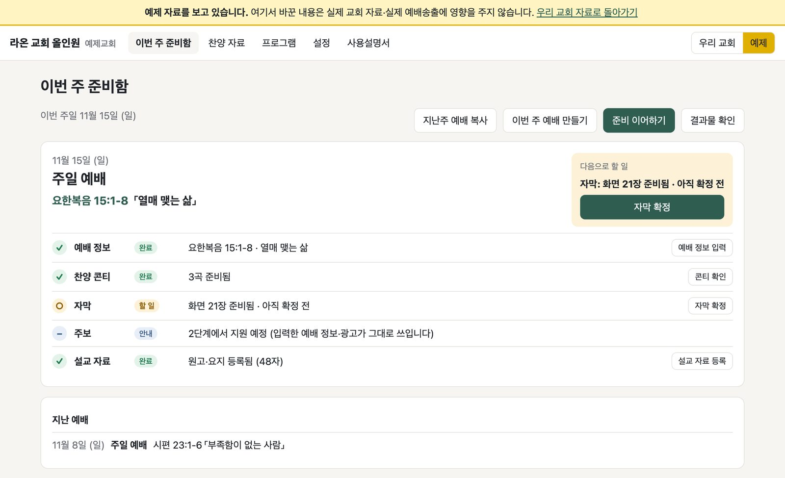

# 라온 교회 올인원 — 이번 주 준비함

> 혼자 목회해도, 매주 준비를 혼자 다 하지 않도록.

1인 목회자를 위한 **이번 주 예배 준비 화면**입니다. 이미 쓰고 있는 프로그램을 새로 만들지 않고 한 화면에 이어 주고, 성도 명부·재정·행정(일정·회의록·봉사 배정·증명서)도 함께 관리합니다. 맥과 윈도우에서 씁니다. 무료로 나눕니다.

## 받기

**[소개·받는 곳 → raon-easypaster.github.io/church-allinone](https://raon-easypaster.github.io/church-allinone/)** · [최신 릴리스](https://github.com/raon-easypaster/church-allinone/releases/latest)



| 파일 | 내용 |
|---|---|
| **ChurchAllInOne-mac.zip** | 맥 (애플 칩·인텔) — 압축 풀고 `설치하기.command`를 오른쪽 버튼 → 열기 |
| **ChurchAllInOne-windows.zip** | 윈도우 10·11 — 압축 풀고 `라온 교회 올인원` 폴더의 `라온 교회 올인원 실행.cmd` 두 번 누르기 (설치 과정 없음, Node.js 들어 있음) |
| SHA256SUMS.txt | 받은 파일 확인값 |

- 둘 다 [예배송출](https://github.com/raon-easypaster/worship-caster)(자막·콘티 송출)과 PraiseFlow 찬양 큐레이터가 함께 들어 있습니다.
- 처음엔 '예제'로 둘러볼 수 있습니다. 예제에서 바꾼 것은 실제 자료에 영향이 없습니다.
- 사용법은 프로그램 위 메뉴 **사용설명서**에 있습니다.
- 문의: [카카오 오픈채팅](https://open.kakao.com/o/gSkET2Wi) · [GitHub 의견 게시판](https://github.com/raon-easypaster/church-allinone/issues)
- AI 기능(찬양 추천·설교 후 자료 10종)은 이 컴퓨터에 [Claude Code](https://claude.com/claude-code) 또는 Codex를 설치·로그인해 두면 API 키 없이 쓰고 있는 구독으로 동작합니다.

## 하는 일

| 하는 일 | 담당 프로그램 | 라온 교회 올인원이 하는 연결 |
|---|---|---|
| 예배 정보(날짜·본문·설교 제목·대표 기도·광고), 설교 원고 | **라온 교회 올인원** | 한 번 입력 → 예배송출 자막에 자동 반영 |
| 찬양 가사·곡 구성·자막 편집·송출(예배당 TV, OBS) | **예배송출** (`~/Applications/예배송출.app`, 5300) | 예배 순서 만들기·지난주 복사, 콘티(곡 넣기·순서·조성·곡 구성), 준비 상태 확인, 확정본 보관 |
| 찬양곡 추천 | **PraiseFlow 찬양 큐레이터** (5173) | 콘티 탭에서 곡 수를 정해 추천받기(꺼져 있으면 자동으로 켬), 결과는 예배 기록에 보관. 찬양 자료에 있는 곡은 바로 넣고(같은 제목 곡은 구분해서), 없는 곡은 예배송출에 새 곡으로 만들어 넣음(가사는 예배송출에서). AI 연결 상태 표시. PraiseFlow는 Claude 구독·ChatGPT 구독(이 컴퓨터의 Claude Code·Codex 로그인) 또는 Gemini API 키 중 골라 씀 |
| 설교 후 자료 | **라온 교회 올인원** + 이 컴퓨터의 AI 구독 (Claude Code·Codex) | 예배 화면 '설교 후 자료' 탭: 설교 원고(300자 이상, 워드 .docx·한글 .hwpx·.txt 파일에서 가져오기 가능)로 설교 인포그래픽, 카드뉴스·말씀카드(PNG 저장), 주보·문자용 요약, 블로그 글, 소그룹 나눔지 장년·청소년, 한 주 묵상(7일), 가정예배지, 쇼츠 대본, 설교 점검(목회자용)을 만들어 예배 기록에 보관. 한꺼번에 만들기(두 개씩 차례로), 설정의 신학 관점·말투 반영. 열어 보기·파일로 받기·글 복사. AI가 만든 페이지는 sandbox로만 열어 라온 교회 올인원 자료에 접근 못 함 |
| 성도 명부·심방·출석 | **라온 교회 올인원** | 성도 한 분의 심방·출석·헌금·봉사·증명서를 날짜순으로 모아보기, 가족 묶기, 엑셀 붙여 넣기·CSV 내보내기, 심방 기록·예정, 출석 체크. 홈 화면에 7일 안 생일·심방 예정·3주 연속 결석 |
| 재정 | **라온 교회 올인원** | 수입·지출 장부(여러 줄 입력), 예산·결산 보고서 인쇄, 기부금 영수증(성도 명부 주소 포함), 항목 직접 편집, 기존 회계장부 백업(JSON) 가져오기 |
| 행정 | **라온 교회 올인원** | 교회 일정 달력, 구글 캘린더 여러 개 받아 보기(비공개 iCal 주소)·.ics 내보내기, 회의록(회의 이름 편집), 예배 봉사 배정표(돌아가며 채우기·인쇄), 교인·세례 증명서와 발급 대장 |
| 회의록 작성기 | **라온 교회 올인원** + whisper.cpp + AI 구독 | 녹음하기·녹음 파일·녹취록 붙여 넣기 → 이 컴퓨터에서 받아 적기(whisper.cpp, 맥은 `brew install whisper-cpp`, 윈도우는 화면에서 공식 배포판 받기) → AI가 내용 정리·결정 사항·해야 할 일로 정리 |
| 설교 쇼츠 | **설교 쇼츠 제작** (3939) | 설교 영상 주소 보관·복사, 열기 |
| 회계 (기존) | **회계장부** (5180) | 열기. 백업 파일을 라온 교회 올인원 재정으로 복사해 올 수 있음 |
| 기타 | 주간묵상 생성기, HWP/PDF 변환기 | 열기 |

## 소개 페이지
`docs/` 폴더가 GitHub Pages(https://raon-easypaster.github.io/church-allinone/)로 공개됩니다. 화면 사진은 모두 예제 자료(`?ws=sample`로 열기)로 찍었습니다.

## 설치 묶음 만들기 (개발자용)
- 맥: `installer/make-package.sh` → 바탕화면에 `교회올인원-설치-날짜.zip`
  - 라온 교회 올인원 + 예배송출.app + PraiseFlow. 교회 자료(`data`), API 키(`.env.local`), `node_modules`, 백업 폴더는 넣지 않습니다.
  - 받는 맥에서 `설치하기.command`: Node.js가 없으면 nodejs.org 공식 파일(체크섬 확인)을 `~/.local/node`에 설치하고, `~/교회 올인원`·`~/Applications/예배송출.app`·`~/Documents/praiseflow---예배-찬양-큐레이터`에 설치, 바탕화면 아이콘 생성. 다시 실행하면 프로그램만 바꾸고 자료는 그대로.
- 윈도우: `installer/make-windows.sh` → 바탕화면에 `ChurchAllInOne-windows.zip`
  - 공식 `node.exe`(체크섬 확인), 빌드된 라온 교회 올인원·PraiseFlow 화면, [예배송출 최신 윈도우판](https://github.com/raon-easypaster/worship-caster/releases/latest)(체크섬 확인)을 한 폴더에 묶습니다.
  - 자료는 `%APPDATA%\ChurchAllInOne`(예배송출은 `%APPDATA%\WorshipCaster`)에 저장되어 폴더를 바꿔도 남습니다.
  - 윈도우에서는 `apps.json`의 `win` 설정이 있는 프로그램(예배송출·PraiseFlow)만 보입니다.
- 설교 쇼츠·회계장부·주간묵상·HWP 변환기는 묶음에 없습니다(자료가 프로그램 폴더 안에 있어서). 맥에서 따로 설치하면 '프로그램' 화면에 나타납니다.

## 사용설명서
프로그램 위 메뉴 **사용설명서**(`/guide`, 화면 사진 포함 · 사진은 `public/guide/`)에 처음 시작·매주 준비 순서·설교 후 자료·AI 구독 연결·백업·설치·자주 묻는 질문을 정리했습니다. 교회 정보를 넣기 전에도 볼 수 있습니다.

## 실행
`교회 올인원 열기.command` 를 두 번 누르거나:

```bash
npm install && npm run build && npm start   # http://localhost:5191
```

- 개발: `npm run dev` (서버 5191 + 화면 5192), 테스트: `npm test`
- 환경 변수: `PORT`(기본 5191), `HUB_DATA_DIR`(기본 `./data`), `WC_URL`(기본 `http://127.0.0.1:5300`), `PRAISEFLOW_URL`

## 자료와 안전
- 성도·재정·행정 자료는 AI나 인터넷으로 보내지 않습니다. 회의록 AI 정리를 누를 때만 녹취록 글이 AI 구독으로 갑니다. 녹음 파일은 `data/recordings/`.
- 라온 교회 올인원 자료: `data/real.json` (우리 교회 · 윈도우는 `%APPDATA%\ChurchAllInOne`), `data/sample.json` + `data/sample-caster.json` (예제). 매일 자동 백업 `data/backups/` 14일 보관.
- **예제 모드**는 실제 예배송출을 건드리지 않는 가상 예배송출을 씁니다. 예제 찬양 가사는 저작권 문제를 피하려고 직접 쓴 글입니다.
- 예배송출에는 같은 컴퓨터 안에서 서버끼리만 요청합니다(예배송출 보안 규칙상 브라우저에서 직접 부를 수 없음).
- 예배 기록을 지워도 예배송출의 예배 순서는 지우지 않습니다.

## 확정본
예배송출은 수정 즉시 송출 화면에 반영되고, 조성·곡 구성은 곡 자체에 저장됩니다(다른 주에도 같이 바뀜).
그래서 라온 교회 올인원이 **자막 확정** 때 예배 순서와 모든 자막을 따로 떠 둡니다. 확정 뒤 바뀐 곳을 알려 주고, 확정본으로 되돌릴 수 있습니다.

## 인터넷 없이
- 라온 교회 올인원 화면·저장은 외부 주소를 부르지 않습니다(브라우저 요청 기록으로 확인: 모두 localhost).
- 자막 송출은 예배송출이 담당합니다. 찬양 추천·설교 후 자료 만들기·회의록 AI 정리·가사 인터넷 검색·구글 캘린더 받기·쇼츠는 인터넷이 필요합니다. 회의 녹음 받아 적기는 인터넷 없이 됩니다(모델은 처음 한 번 받음).

## 후원 안내
라온 교회 올인원은 자율 후원으로 운영됩니다. 후원은 부담을 갖지 않으셔도 됩니다. 무료로 사용하셔도 괜찮습니다.

- 카카오뱅크 3333-01-9034483 (이광복)
- 프로그램 안에서는 '설정' 화면 아래와 모든 화면 맨 아래 '후원 안내'에서 볼 수 있습니다.

## 다음 단계
2단계: 주보(인쇄용·모바일, 교회별 양식).

---
만든 사람: **쉬운목사 이광복** (라온동행교회) · 무료로 나눕니다.
